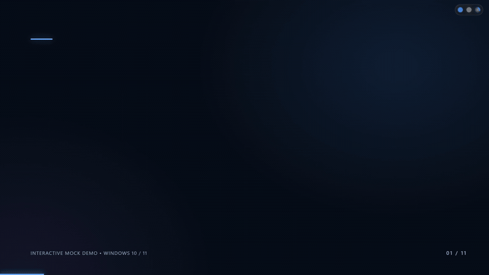

# Dot Notifier

[](https://www.microsoft.com/windows)
[](https://tauri.app/)
[](https://react.dev/)
[](https://www.typescriptlang.org/)
[](https://github.com/KidKyzo/dot-notifier/releases)

A lightweight, non-intrusive Windows desktop overlay designed for multi-tasking developers. Dot Notifier places ambient, minimal indicators in your screen corner to track **AI agent progress**, **Windows notifications**, and **system performance**—expanding into informative pills and panels only when you need them.

## Demo Video



[Watch the full demo (MP4)](assets/demo/dot-notifier-demo.mp4). This recording uses the local mock UI; native Windows integrations require a separate manual check.

---

## Overview & Concept

When working with long-running AI coding agents (such as Codex, Antigravity, or Claude Code), switching windows or constantly checking terminal tabs breaks flow state. Windows toast notifications are disruptive and clutter the screen.

Dot Notifier solves this with an ambient **three-dot micro-UI** positioned seamlessly in your display's work area:

1. **AI Task Dot** – Monitors running, waiting, finished, or errored agent workflows in real-time across Codex, Antigravity (App, CLI, and IDE), and Claude Code.
2. **Notifications Dot** – Surfaces incoming notifications (e.g., WhatsApp, chats, system apps) with privacy-first ephemeral filtering, incoming call banners, and Action Center deduplication.
3. **System Dot** – Tracks CPU, RAM, and GPU load with dynamic threshold alerts, cooldown protection, and resource sparklines.

### Overlay States

| State              | Visual Behavior                                                                                                                                                           | Trigger                                                                      |
| ------------------ | ------------------------------------------------------------------------------------------------------------------------------------------------------------------------- | ---------------------------------------------------------------------------- |
| **Idle**     | Low-opacity, minimal dots sitting cleanly in the screen corner.                                                                                                           | Default quiescent state                                                      |
| **Alert**    | Dot pulses or transitions color (blue = running, green = complete, orange = waiting/needs input, red = error).                                                            | New event or state change                                                    |
| **Peek**     | Morphing glass pill (icon + concise single line) that auto-dismisses after 3–4 seconds. Supports**approval actions** and **grouped multi-event coalescing**. | Incoming chat, task finished, permission prompt, or metric threshold crossed |
| **Expanded** | Interactive flyout panel with detailed task queues, chat history, media player, and hardware sparklines.                                                                  | Hover or click                                                               |

---

## Key Features

- **Click-Through Transparency**: Fully transparent overlay that ignores clicks on empty areas; input is captured only when interacting with dots, pills, or open panels.
- **Interactive Agent Approvals (Phase F)**:
  - Respond to agent tool and permission requests directly from the HUD (`Approve`, `Reject`, `Dismiss`).
  - Secured with single-use action nonces and timeout fallthrough to the terminal (never auto-approves).
- **Multi-Agent & Mixed Peek Coalescing (F43)**:
  - Simultaneous events within a 1.5-second window coalesce into a single unified pill showing all updates (e.g., Antigravity task finished + WhatsApp message) with a `+N more` overflow badge instead of overlapping toasts.
- **Click-to-Focus Process Window (Phase D / F34)**:
  - Clicking an agent task row or notification item brings the target process or terminal window to the foreground via process-tree handle traversal.
- **Local-First & Ephemeral Privacy**:
  - Operates over an isolated local WebSocket event bus (`127.0.0.1`) secured by a per-session handshake token.
  - No message bodies, prompts, or private chat contents are stored to disk. Chat retention is strictly memory-only (1-hour window).
  - Zero cloud sync, zero telemetry, and zero outbound network tracking.
- **Now Playing Media Controls**:
  - Windows System Media Transport Controls (SMTC) integration for Spotify, Apple Music, and opt-in browser media (YouTube Music) with album artwork and playback toggles.
- **WhatsApp & Messaging Enhancements**:
  - Distinct sender avatars with deterministic color hues, single-line message preview, incoming call banner detection, and quick "Open WhatsApp" action.
  - Action Center deduplication ensures lingering notifications do not trigger repeated re-peeks.
- **Adaptive Polling & Efficiency**:
  - Hardware performance counters poll at ~2 s intervals while idle, dropping to 0.5–1 s only when the metrics panel is expanded.
  - Strictly adheres to resource budgets: idle CPU < 1%, idle RAM < 80 MB.
- **Multi-Monitor, Taskbar Aware & System Tray**:
  - Anchors cleanly to any screen corner (Top-Left, Top-Right, Bottom-Left, Bottom-Right) without being clipped by the Windows taskbar.
  - Native Windows system tray with DPI-aware icons (100%–200% scaling, light/dark taskbar themes), single-instance enforcement, and native Windows registry auto-start (`--hidden` flag).
- **Motion Lab & Mock Mode**:
  - Develop and iterate on the UI completely inside the browser (`pnpm dev:mock`).
  - Includes a dedicated Motion Lab (`/#lab`) to benchmark spring transitions, refresh rates (60/120/144 Hz), and glassmorphism contrast over light and dark wallpapers.

---

## Supported AI Agents

| Agent                               | Integration Mechanism                                              | Capabilities                                                          | Configuration / Location                                      |
| ----------------------------------- | ------------------------------------------------------------------ | --------------------------------------------------------------------- | ------------------------------------------------------------- |
| **Codex CLI**                 | Rollout watcher +`notify` hook + `[[hooks.PermissionRequest]]` | Running, Done, Error, Waiting for Input, Interactive Approve / Reject | `~/.codex/config.toml`                                      |
| **Antigravity 2.0 App**       | Transcript watcher +`PreInvocation` & `Stop` hooks             | Running, Done, Error (observe-only, privacy-first)                    | `~/.gemini/antigravity/brain/`                              |
| **Antigravity CLI (`agy`)** | Transcript watcher +`PreInvocation` & `Stop` hooks             | Running, Done, Error (observe-only, synchronous hook safe)            | `~/.gemini/config/hooks.json` or `settings.json`          |
| **Antigravity IDE**           | Transcript watcher +`.agents/hooks.json` / `hooks.json`        | Running, Done, Error, deduplicated by`conversationId`               | `.agents/hooks.json` / `~/.gemini/antigravity-ide/brain/` |
| **Claude Code**               | Shell hook script (`claude-notify.ps1`)                          | `Stop`, `Notification`, `PermissionRequest`                     | `~/.claude/settings.json`                                   |

---

## Tech Stack

- **Desktop Framework**: [Tauri 2](https://tauri.app/) (Rust core with Windows MSVC toolchain, WinRT `UserNotificationListener`, PDH performance counters, NVML integration, and Win32 process/window APIs).
- **Frontend**: [React 19](https://react.dev/), [TypeScript](https://www.typescriptlang.org/), [Vite](https://vitejs.dev/).
- **Styling**: Fluid modern CSS with spring morphing animations and simulated glassmorphism.
- **Testing**: [Vitest](https://vitest.dev/) for frontend unit tests; `cargo test` for Rust bus, adapter parsers, approval nonces, and system monitor logic.

---

## Project Structure

```
├── .github/workflows/         # CI check & automated validation workflows
├── assets/                    # Icons and demo media
│   ├── demo/                  # README demo gif & mp4
│   └── icon/                  # Vector master icon source
├── docs/                      # PRD, event schemas, design palettes, checklists, spikes
│   ├── PRD.md                 # Product specifications and milestones
│   ├── event-schema.md        # WebSocket bus event schema & specs
│   ├── motion.md              # Motion lab benchmarks & styling tokens
│   ├── manual-checklist.md    # Verification checklist
│   └── spikes/                # Verification spikes for Codex, Antigravity, Media
├── fixtures/                  # Real-world test fixtures for adapters
├── scripts/                   # Integration bridges and validation helpers
│   ├── antigravity-notify.ps1 # Antigravity app, CLI & IDE hook bridge
│   ├── codex-notify.ps1       # Codex notification & permission bridge
│   ├── claude-notify.ps1      # Claude Code notification bridge
│   ├── check-rust.mjs         # Rust formatting, clippy, and test runner
│   └── generate-readme-demo.mjs # Demo generation script
├── src/                       # Frontend application (React 19 + TypeScript)
│   ├── core/                  # Event store, state machine, settings, metrics, task list
│   ├── App.tsx                # HUD dynamic overlay component
│   ├── MotionLab.tsx          # Motion and visual contrast testing lab
│   └── main.tsx               # Client entry point
├── src-tauri/                 # Rust desktop shell (Tauri 2)
│   ├── src/
│   │   ├── antigravity_hooks.rs   # Antigravity hooks.json installer & backup
│   │   ├── antigravity_logs.rs    # Antigravity transcript watcher (App, CLI, IDE)
│   │   ├── approvals.rs           # Nonce-bound approval actions & fallthrough
│   │   ├── bus.rs                 # Local WebSocket bus (127.0.0.1 + token)
│   │   ├── codex_logs.rs          # Codex rollout & permission watcher
│   │   ├── focus.rs               # Process tree to window handle activation
│   │   ├── media_controls.rs      # Windows SMTC Now Playing listener
│   │   ├── notification_filter.rs # Notification filtering & deduplication
│   │   ├── system_monitor.rs      # PDH & NVML hardware telemetry
│   │   ├── win_notifications.rs   # WinRT toast notification listener
│   │   └── lib.rs                 # Tauri setup, window hit-testing, tray, auto-start
│   └── tauri.conf.json        # Tauri configuration & window metadata
```

---

## Getting Started

### Prerequisites

- **Node.js**: `24` or newer
- **pnpm**: `11.25.0` (managed via `corepack enable pnpm`)
- **Rust**: Stable with MSVC toolchain (`rustup default stable-x86_64-pc-windows-msvc`)
- **Windows Build Tools**: Microsoft C++ Build Tools and WebView2 Runtime (pre-installed on Windows 10/11)

### Installation

Clone the repository and install dependencies:

```powershell
git clone https://github.com/KidKyzo/dot-notifier.git
cd dot-notifier
pnpm install
```

---

## Development & Testing

### 1. Run in Mock Mode (Fast UI Development)

Run the frontend in your browser with realistic mock events without compiling Rust:

```powershell
pnpm dev:mock
```

- Navigate to `http://localhost:1420/` for the interactive HUD and synthetic event controls.
- Navigate to `http://localhost:1420/#lab` to open the **Motion Lab** for testing spring curves, refresh rates, and contrast over synthetic wallpapers.

### 2. Run the Full Native Desktop App

Launch the full Tauri 2 app with native Windows hooks, notification listener, and live hot-reloading:

```powershell
pnpm app:dev
```

### 3. Run Validation & Quality Checks

Run the complete test suite (TypeScript typecheck, ESLint, Vitest frontend tests, and Rust format/clippy/unit tests):

```powershell
pnpm check
```

You can also run individual checks:

```powershell
pnpm typecheck   # Typecheck TypeScript files
pnpm lint        # Run ESLint
pnpm test        # Run Vitest unit tests
```

---

## Building a Release

To compile an optimized production build and generate the Windows installer / standalone binary:

```powershell
pnpm app:build
```

The output bundles (`.exe` installer and portable executables) will be located in `src-tauri/target/release/bundle/`.

---

## Integration Bridges

Dot Notifier comes with bridge scripts for agent hooks located under `scripts/`:

- `codex-notify.ps1`: Integration hook for Codex agent lifecycle events and permission requests.
- `antigravity-notify.ps1`: Bridge hook for Antigravity 2.0 app, CLI (`agy`), and IDE status tracking.
- `claude-notify.ps1`: Bridge hook for Claude notifications and permission events.
