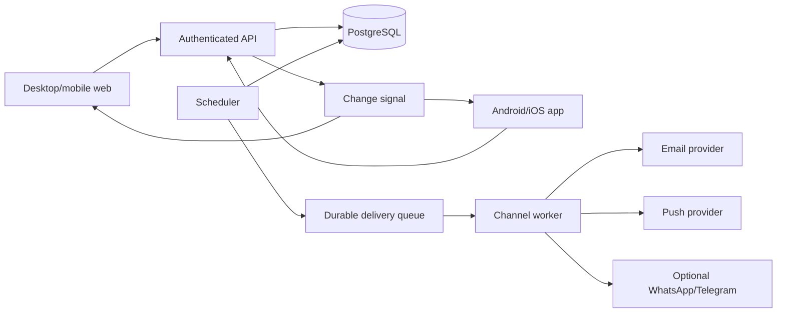

# Personal Reminder Hub — Development Plan

Status: proposal · 10 October 2026 · Requirements: [PRD.md](PRD.md)

## 1. Delivery approach

Build this as a separate product/workspace from the existing Dot Notifier application. Preserve Dot Notifier's Windows-only, local-first scope until an integration is explicitly chosen. The [reference repository](https://github.com/mayowa-id/smart-daily-task-reminder) provides a useful Spring Boot scheduling and channel example, but its README describes a small H2-backed app with fixed water/stretch routines and manual reminder endpoints. Treat it as a concept reference; audit license, code, and security before any reuse.

**Proposed stack, to confirm at kickoff:** Spring Boot API and worker, PostgreSQL for durable data, React/TypeScript responsive web client, and React Native mobile clients in V1. This keeps the reference project's backend language but replaces H2 with a production database. Use hosted push delivery for mobile and a transactional email provider. Select hosting, auth, push, and email vendors after a short cost/security review; this document does not authorize dependency changes in the current repo.

## 2. System shape

The server owns time calculation and occurrence status. Clients may cache state, but cannot independently create authoritative occurrences. The scheduler and workers can restart without duplicating occurrences or logical sends.

## 3. Data model and contracts

| Entity | Minimum fields and constraints |
| --- | --- |
| `users` | ID, verified email, timezone, quiet hours, deletion state |
| `categories` | ID, owner ID, name, color, sort order, archived flag; unique active name per owner |
| `reminder_series` | ID, owner ID, category ID, title, optional note, schedule rule, timezone, active hours, status, version |
| `occurrences` | ID, series ID, due UTC, local date/time, status, snoozed until, completed at, version; unique series ID + recurrence key |
| `delivery_preferences` | Owner/series scope, channel, enabled flag, verified destination reference, quiet-hour behavior |
| `delivery_attempts` | Occurrence ID, channel, stable send key, state, attempt count, next retry, provider reference; unique logical send key |
| `devices` | Owner ID, device ID, push token reference, platform, last seen, revoked at |

API surface to specify in OpenAPI before implementation: authenticated reminder/category CRUD; schedule preview; paginated active/upcoming/history; `POST /occurrences/{id}/done`, `/skip`, `/snooze`, `/undo` with idempotency key and expected version; channel verification/preferences; devices; export; account deletion. All writes include ownership checks and return updated server state. Sync payloads carry stable IDs and monotonically increasing versions, with cursor pagination for reconnect.

Schedule rules are validated against the supported shapes in R2. Define recurrence keys from series ID and local scheduled slot rather than worker execution time. Store due time in UTC plus the original timezone/rule. Use a transaction and uniqueness constraints when generating occurrences. Generate only a bounded horizon (for example 30 days) so an hourly series cannot create an unbounded table. The exact horizon is an implementation choice to benchmark before release.

## 4. Phases and exit gates

Estimates are planning ranges for one full-time developer plus part-time design/QA. They are not commitments; provider approvals and app-store review are outside the engineering estimate.

| Phase | Estimate | Scope and exit gate |
| --- | --- | --- |
| 0. Discovery and design | 1 week | Confirm target platforms, channels, notification volume/cost, accessibility baseline, privacy/retention policy, and reference license. Produce wireframes, data dictionary, OpenAPI draft, and provider selection. Exit: signed-off scope and schedule examples. |
| 1. Scheduling core | 2–3 weeks | Build schema, auth boundary, recurrence validation/preview, timezone/DST handling, occurrence generator, and category/reminder APIs. Exit: deterministic tests for all recurrence and month-end/DST cases; duplicate generation prevented in concurrent runs. Covers R1–R4. |
| 2. Responsive web workflow | 2–3 weeks | Implement sign-in, creation/editor, categories, Active/Today/Upcoming/History, Done/Skip/Snooze, and live sync. Exit: two browsers show the same state; completion clears an active occurrence on both. Covers R3–R7. |
| 3. Delivery and privacy | 2 weeks | Add in-app alerts, verified email opt-in, quiet hours, durable queue, retry/idempotency, account export/deletion, rate limits, and internal delivery status. Exit: one logical email per occurrence/channel across worker restart; no note/contact data in logs. Covers R8–R9/R13. |
| 4. Mobile apps and push | 3–4 weeks | Build Android/iOS clients using same API, device registration/revocation, push permission flow, deep links, cached read, and queued offline actions. Exit: both platforms receive alerts and reconcile Done/Skip/Snooze from either device. Covers R10–R11. |
| 5. Pilot and release | 1–2 weeks | Accessibility audit, load and clock-change tests, security review, backup/restore drill, usability test, documentation, monitored pilot, and bug fixes. Exit: PRD quality bars pass and rollback is rehearsed. |
| 6. Optional channels | Separate decision | Pilot one official provider at a time, starting with the channel users choose in discovery. WhatsApp requires opt-in, approved templates, delivery budget, opt-out, and provider webhooks. Exit: approval and cost per active user are acceptable; R12 passes. |

Estimated MVP (phases 0–3 and 5): 8–11 weeks. Estimated V1 with native mobile (phase 4): 11–15 weeks, excluding store/provider review. Run phases sequentially until the scheduling and completion contract is stable; design work can overlap engineering.

## 5. Verification plan

| Level | Required cases |
| --- | --- |
| Unit | Hourly active-hour bounds; daily/weekly/monthly rules; month-end; DST gap/repeat; quiet hours; superseding unresolved occurrences; Done/Skip/Snooze/Undo; category fallback; schedule preview. |
| Integration | Auth and ownership; concurrent scheduler instances; transaction rollback; worker restart; provider timeout/retry; email bounce/suppression; duplicate action from two devices; stale version conflicts; export/deletion. |
| End-to-end | Create a reminder on desktop, receive it on mobile, complete on mobile, verify desktop clears it, and verify the next recurring occurrence appears only once. Repeat for offline/reconnect and each enabled channel. |
| Manual | Windows/Android/iOS notification permission denial, background/locked device, timezone travel, DST transition using controlled clock, accessibility with keyboard/screen reader, and provider opt-out. |

Use a fake clock and fake providers in automated tests. Keep fixtures for provider responses and malformed webhook bodies. Never send live messages in default CI. A staging pilot with test accounts validates actual email and push delivery because provider acceptance is not proof of display.

## 6. Delivery safeguards

- Authenticate every API route; authorize per owner, including category and occurrence relationships. Verify webhook signatures and reject malformed payloads.
- Enqueue through a transactional outbox or equivalent so state and delivery intent cannot diverge. Before send, recheck that the occurrence is active and channel still enabled. Retry transient failures with backoff and bounded attempts; suppress permanent failures.
- Store provider secrets in a managed secret store, not client code or repository files. Encrypt transport and protect push tokens/contact destinations. Log IDs, status codes, and timings; omit notes and full destination values.
- Rate-limit sign-in, verification, schedule preview, and sends. Prevent a single hourly reminder from producing unlimited external messages. Provide a channel volume estimate before enabling it.
- Back up the database, document restore and migration procedures, and test an account deletion path that removes device tokens and future deliveries.
- Keep account/service email separate from future marketing email. Set up sender authentication and bounce/complaint suppression before production sending.

## 7. Decisions needed before implementation

1. Is desktop access through a responsive web app sufficient, or is a native Windows app required at launch? The current Dot Notifier overlay is a separate integration decision.
2. Are both Android and iOS required for the first public release, and in which countries will the product launch?
3. Which external channel should follow email and push: WhatsApp, Telegram, or neither? What monthly per-user delivery budget is acceptable?
4. How long should completion history be retained by default, and should users be able to remove it earlier?
5. Is the reference project's code licensed for reuse? If not, build original implementation from the product specification.

## 8. Source notes

- [Reference repository README](https://github.com/mayowa-id/smart-daily-task-reminder): current example features, stack, and channels.
- [Firebase Cloud Messaging overview](https://firebase.google.com/docs/cloud-messaging): trusted server and Android/iOS/web push delivery model.
- [Twilio WhatsApp overview](https://www.twilio.com/docs/whatsapp/api): opt-in and approved templates for business-initiated messages.
